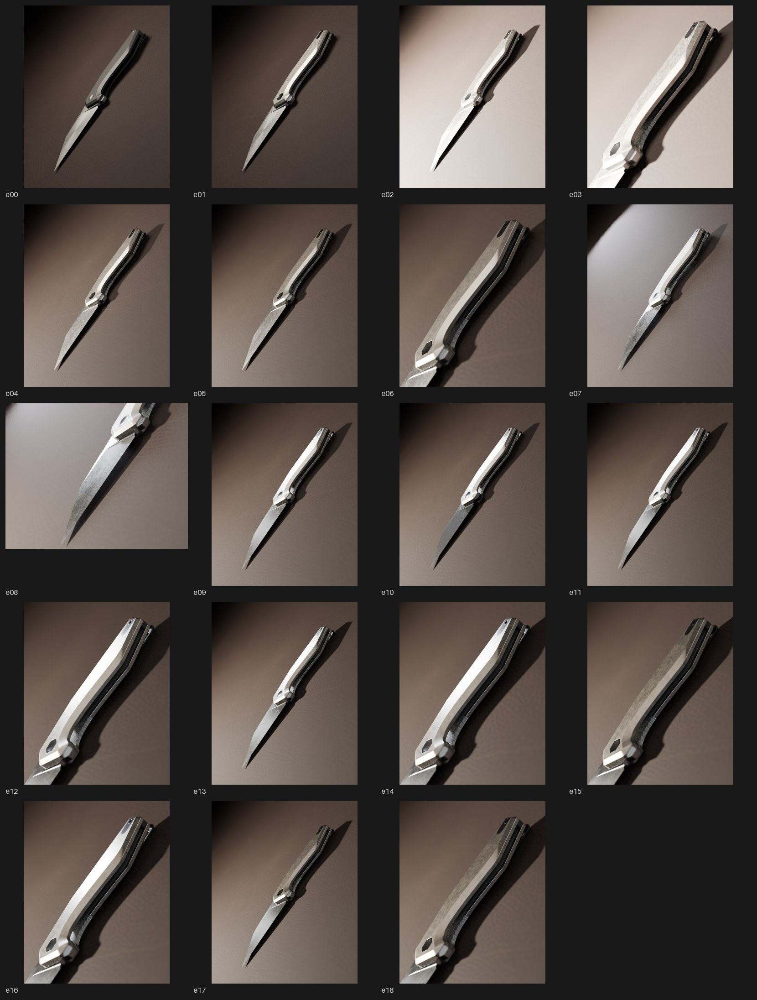

# Fenrir lookdev takeover — 19 inspected drafts & two hero candidates

Rendered & visually inspected by Claude on 2026-10-11 in a Linux container: Blender 5.2.2 LTS (official Linux build, sha256 `84098912…8a168`), Cycles **CPU**, 4 cores, denoise off, 96 fixed samples for drafts, 256 for heroes. No GPU was involved; every job is a worker `lookdev` authoring job run through `tools/run_authoring.py`, so each image is reproducible on the Windows OPTIX host by rebinding `source`, `output_dir` & `--blender`.

Nothing here is an approved finish or an accepted advertisement. All manifests remain `reviewed:false`. The images are the first visual evidence that the known defects (uniform slab handle, paper blade, flat white chamfer band, invisible texture scale) are resolved at physical scale.

## Product truth used (fetched 2026-10-11, not CAD labels)

Damned Designs Fenrir folder, titanium variant. Sources: [Knife Informer review](https://knifeinformer.com/damned-designs-fenrir-review) (titanium sample, teardown photo) & [Kaviso listing](https://kaviso.com/products/damned-designs-fenrir) (G10 / 154CM, blade finish "Stonewashed"). The Damned Designs product page is gone (404), so no official images exist.

| Part (CAD name) | Role from teardown photo | Finish used in `ti_stonewash_v1` |
|---|---|---|
| `FENRIR_HANDLE_TOP_v002`, `FENRIR_HANDLE_BOTTOM_v002` | titanium scales, "contoured all the way around, with a wide bevel towards the outside transitioning into chamfered edges" | stonewashed Ti: warm mid-grey, 2.2 mm tumble mottle, sparse 6 mm scratches, 0.3 mm shader bevel with burnished chamfers |
| `FENRIR_BLADE_v1` | blade; "nearly full flat grind"; stonewashed (154CM/S35VN) or black coated (14C28N sample) | stonewashed steel (default) or black coated (`blade_finish`) |
| `FENRIR_HANDLE_TOP_v004`, `FENRIR_HANDLE_BOTTOM_v003` | nested stainless liners | bead-blast steel |
| `FENRIR_HANDLE_TOP_v1`, `FENRIR_HANDLE_BOTTOM_v1` | plastic backspacer halves | black plastic |
| `FENRIR_HANDLE_BOTTOM_v001` | "black painted deep carry spring steel" clip | black paint |
| `FENRIR_HANDLE_TOP_v001` | blanking plate (clip side opposite) | black hardware |
| `FENRIR_PIVOT`, pivot screw, back screws, `Part3` | oversized hex pivot & T8 hardware, black in every photo | black hardware |
| `FENRIR_HANDLE_TOP_v003` | stop pin | bead-blast steel |

Part roles were verified visually with the colour-coded [top](part-id-top.png) & [side](part-id-side.png) ID renders. The CAD material label `Anodized_Aluminum_Rough_Black` on the scales is wrong for the titanium variant & was not used. Blade steel/finish & the exact variant still need Adrian's confirmation; `blade_finish` carries both options so the choice costs one render.

## Iterations (one visible issue, one change, rerender, inspect)

| Image | Change | Visible finding |
|---|---|---|
| [e00](e00.jpg) | Codex angle 21 job rerun on CPU, 480×600 | Reproduces angle 21 exactly: baseline for every comparison. |
| [e01](e01.jpg) | `finish_profile: ti_stonewash_v1`, lighting unchanged | Handle becomes metal with tumble & warm tone; black backspacer/clip/pivot separate. Mottle reads as salt-and-pepper sandpaper; blade reads as grey paper; wide outer chamfer is a flat white band. |
| [e02](e02.jpg) | + hard accent light 60 W, 3 cm | Far overexposed, but the small source casts a photographic hard shadow & makes the tumble sparkle. Keep the light, cut power. |
| [e03](e03.jpg) | handle detail crop (`frame_part: 1`) | Confirms ~1 mm mottle is readable but too granular versus the review photos. |
| [e04](e04.jpg) | softer tumble (bright .12, cells 2.2 mm), key 2 W, accent 8 W | Handle calmer; chamfer band still flat white because a uniform disk reflects in a flat facet. |
| [e05](e05.jpg) | `key_gradient: 1.5` feathered graded key card replaces disk | Chamfer carries a gradient instead of a stripe; blade starts to grade. |
| [e06](e06.jpg) | detail crop of e05 | Cloudy tumble, sparse scratches, graded chamfer, black hex: closest to the Knife Informer handle photo so far. |
| [e07](e07.jpg) | blade roughness .22, blade mottle .07, fill 2.5, rim 3 W | Blade now satin stonewash with gradient; the rim lit the leather into a bright blob (rejected placement). |
| [e08](e08.jpg) | blade detail crop (`frame_part: 2`) | Flat-grind/primary bevel transition reads; tumble scale matches the Kaviso stonewashed blade photo; blade dark because it reflects the dark set. |
| [e09](e09.jpg) | graded reflection card aimed into the blade flat (`blade_card: 2.5`, blade-only light linking), rim linked to knife | First frame that reads as a photographed product. Chamfer still blows white. |
| [e10](e10.jpg) | `blade_finish: black_coated` | Black-coated variant for Adrian's choice; same lighting holds. |
| [e11](e11.jpg) | key card gain 2.5, gradient 2.2, Ti roughness .44 | Whole shot credible; chamfer tamed. |
| [e12](e12.jpg) | detail crop of e11 | Scale flat went silver-satin: tumble washed out. Rejected. |
| [e13](e13.jpg) | darker, warmer Ti (0.34/0.315/0.285), mottle .20, accent 10 W | Whole shot closer to Ti; detail still washed (e14). |
| [e14](e14.jpg) | detail crop of e13 | Still satin-smooth: the wash is lighting, not material. |
| [e15](e15.jpg) | rim light off | Tumble returns strongly: the rim was laying a broad sheen over the flat. Slightly too blotchy. |
| [e16](e16.jpg) | hard 4 cm rim + relief .3 | Rim washes the flat again even when small. Rim rejected for the handle. |
| [e17](e17.jpg) | candidate: rim off, mottle .14, relief .22 | Handle, blade, hardware & grounding all hold at whole-product scale. |
| [e18](e18.jpg) | detail crop of e17 | Tumble at true scale with burnished chamfer & black hex pivot. Candidate for hero. |

Heroes (1080×1350, 256 samples, mottle .12): [h01 titanium + stonewashed blade](h01-ti-stonewash-hero.png) · [h02 titanium + black-coated blade](h02-ti-blackblade-hero.png). Jobs for every image are in [jobs/](jobs/); settings not listed in a job come from `recipes/fenrir-editorial-draft.json`.

## What the loop established

- A broad soft source flattens stonewash; a small hard accent (8–10 W, 3 cm) plus a **graded** key card is what makes tumble & chamfers read. Any additional broad source on the handle flat (rim 3–4 W, even 4 cm) washes the finish out again.
- Finish features must be authored in metres: 2.2 mm Voronoi tumble, 6 mm scratches, 0.3 mm shader bevel on a 204 mm knife. Codex's 0.14 mm noise could never be seen.
- A flat facet reflecting a uniform light is a white stripe. Feathered, graded emitters (the archived v2 softbox technique in `premium_look._softbox`) fix the chamfer & the blade flat.
- The dark editorial set leaves the blade dark unless a card is placed in its specular direction & light-linked to it.

## Still open

- Adrian's confirmation of variant & finishes (titanium scales? stonewashed or black-coated blade?) & his chosen photographic direction.
- Leather set is still a clean CC0 tile; a real prop surface or a photographed macro of the actual product would ground scale further.
- Jimping, pivot engraving & logo etch do not exist in the CAD; they are visible in every product photo.
- Rotation, opening & closing film remains unstarted; these stills only settle finish & lighting for it.

## Composition correction (after Adrian rejected the hero angle)

h01/h02 inherited Codex's angle-21 camera (azimuth −10, elevation 22°, roll −50): a grazing view from the cutting-edge side that shows the scale face as a sliver, hides the blade flat & reads as the knife sliding toward the viewer. That camera was never examined; finish work was done on top of it. Six compositions with the finish & light held constant: [composition-sheet.jpg](composition-sheet.jpg), jobs `c1`–`c6`.

| Candidate | Camera | Read |
|---|---|---|
| c1 | az 0, el 65, roll −35 | full silhouette, show side, hex pivot; slightly flat |
| **c2** | az 0, el 45, roll −40 | full silhouette with depth; chamfer & flats both read. Hero h03 |
| c3 | az 30, el 55 | tip-forward foreshortening, weak |
| c4 | az −30, el 55 | butt-forward, blade dominates awkwardly |
| c5 | az 0, el 15, lens 85 | dramatic low profile but knife tiny, floor dominates |
| **c6** | az 0, el 80, roll −38 | near top-down catalogue read. Hero h04 |

## Propped set (after "knife thrown on a cardboard box")

Flat-on-a-plane compositions (h01–h04) read as catalogue mockups. Adrian's reference 04 is a knife standing tip-down, handle leaning on a dark box, one low warm raking light, black falloff, shallow focus. `pose_lean`/`pose_back` stand the knife on its tip with the show side to camera & lean it back; `prop` adds a dark scuffed box whose top front edge the handle's back flat rests on.

| Image | Change | Finding |
|---|---|---|
| [p01](p01.jpg) | first propped pose, box beside knife | pose right, prop in the wrong place (lean must be in depth) |
| [p03](p03.jpg) | back-lean 16°, box behind | real cast shadow; box a featureless wall |
| [p04](p04.jpg) | short box, handle on its top edge, elevation 8°, f/3.2 | reference-04 structure appears; Ti too cream, box top mirror-like |
| [p05](p05.jpg) | darker Ti, metallic box, cooler key | closer; handle lit flat-on |
| [p06](p06.jpg) | key raked low from the left, box near-black | mood matches; under-lit, blade slab |
| [p07](p07.jpg) | key raised, fill .35, blade card .6 | best propped draft. Hero h05 |
