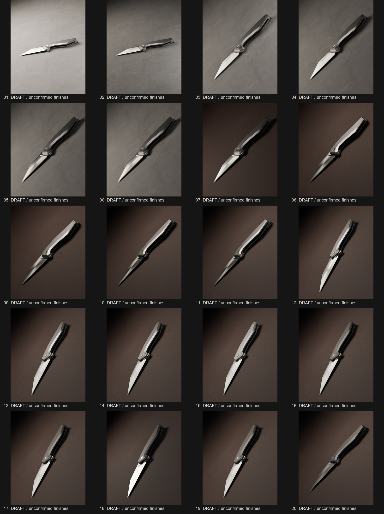

# Fenrir editorial lookdev — 22 inspected drafts

Rendered & visually inspected by Codex on 2026-10-11, Blender 5.2.2 / RTX 4070 Laptop OPTIX. 20 experiments: 960×1200, 96 fixed samples, denoise off. Selected preview rerendered at 1080×1350, 384 samples with identical controls, then visually inspected. No product finish approval or publication acceptance is claimed. Selected draft 17 improves grounding, composition & material separation over rejected blue-void images; its handle remains too uniform & lacks photo-calibrated stonewash. It is an authoring candidate, not a finished advertisement.

[Selected draft PNG](selected-draft.png) · [Parameters, timings & visual observations](iterations.json) · [Proposed 12-photo target board](https://github.com/bogusyogi/workflows/tree/main/brands/damned-designs/references/product-photo)

The board is agent-selected from official brand sites; Adrian has not approved these choices. Primary composition references: DD Basilisk/Fenrir fixed blades (warm leather, close framing, soft steel gradient); Quiet Carry images inform bevel/finish separation only. Reference fixed blades are different products from this folding CAD model.

Provisional metal shaders are appearance studies, not product truth. No G10 texture authenticity is claimed. All manifests remain `reviewed:false`; no Fenrir approval was created. Product owner’s actual finish photos & chat decisions can be recorded as simple version tags without blocking continued draft lighting work.

Each iteration changes one lookdev control after inspecting its predecessor. Initial setup replaced the rejected blue environment, strip reflections & small framing. Failed Blender compositor setup attempts produced no image & are excluded from the 20-image sequence. Two API changes discovered on installed 5.2.2: blur size is an input socket; Map Range & Mix RGB compositor nodes use ShaderNode IDs.

| Image | Visible finding & next action |
|---|---|
| [01](01.jpg) | Concrete gives contact and scale; huge empty upper field; blade highlights nearly white, handle facets too uniform. Reduce broad key by two stops next. |
| [02](02.jpg) | Lower key improved handle contrast and retained concrete texture; blade still bright. Flat horizontal placement wastes portrait frame: turn camera roll for a steep diagonal. |
| [03](03.jpg) | Diagonal fills portrait frame and gives the object presence; concrete is credible, blade is still white and handle slab too even. Reduce the raking light next to reveal blade gradient. |
| [04](04.jpg) | Reducing rake deepened shadows but did not recover blade gradient; broad key covers nearly entire reflection. Halve its size to shape one soft highlight rather than a uniformly white blade. |
| [05](05.jpg) | Smaller key restores steel gradient and blade bevel separation. Highlight remains pinched and chrome-like; increase blade roughness from .30 to .35 for a broader satin response. |
| [06](06.jpg) | Roughness .35 modestly softens blade reflection but does not yet feel photographic. Concrete field is monotonous; compare photographed leather texture against board 2 and 4 without changing lights or camera. |
| [07](07.jpg) | Leather adds warmth and tactile scale versus concrete, closer to references 2/4. Handle face remains flat dark grey; shift key laterally toward its reflected direction to reveal curvature and machining. |
| [08](08.jpg) | Lateral key now reveals bevel contrast and a dark blade gradient, but the handle still resembles a perfect CAD slab. Increase draft microtexture strength to test visibility under this raking response. |
| [09](09.jpg) | Increasing microscopic bump strength made almost no visible difference at this scale; retain as provisional, not a validated stonewash. Lower camera angle to increase depth and distinguish handle face from bevel. |
| [10](10.jpg) | Lower angle creates depth and pleasing focus falloff but blade tip and handle side are too dark. Raise broad cool fill to recover shadow detail while retaining leather warmth. |
| [11](11.jpg) | Fill reveals the lower frame and hardware but composition still reads like a flat slab. Rotate viewing azimuth to show lengthwise perspective and test whether blade reflection becomes less symmetric. |
| [12](12.jpg) | Azimuth improves depth but blade shows an artificial hourglass highlight. Reduce anisotropy from .55 to .25; seek one broad soft highlight like Quiet Carry references, not chrome pinch. |
| [13](13.jpg) | Lower anisotropy removes the false pinched reflection; blade reads calmer. Tip and tail are too soft for a full-product still at this angle, so compare f/8 while preserving focus distance. |
| [14](14.jpg) | f/8 holds tip and tail more clearly while background still falls away. Handle bevel is overly clean and polished; test rougher provisional metal to soften its edge reflection before approving composition. |
| [15](15.jpg) | Roughness softens bevel but handle and blade still have nearly identical value; the monochrome slab lacks the material separation visible in board 2/5/6. Darken provisional handle base only, retaining metal response. |
| [16](16.jpg) | Darker handle separates materials better and retains a quiet bevel. Blade is still excessively perfect; increase provisional lengthwise micrograin to see whether texture survives this framing instead of relying on roughness alone. |
| [17](17.jpg) | Stronger grain is subtle at whole-product scale, so it cannot substantiate a real finish. Blade remains too bright overall. Move key further behind subject to shape its reflection while preserving exposure and camera. |
| [18](18.jpg) | Rejected: moving key behind subject blows blade nearly white and loses its planar detail. Restore previous key position; this failed experiment is retained rather than presented as progress. |
| [19](19.jpg) | Restored key recovers blade shading. Foreshortened view still compresses silhouette and hides tip geometry; compare earlier azimuth with current softer finish response for final draft selection. |
| [20](20.jpg) | Earlier azimuth restores full silhouette, but dark blade loses detail. Prefer 17 for readability and 8 for highlight study. Neither is owner-approved or ready to call a premium ad. Handle still lacks photo-calibrated finish texture. |

Local full-resolution scenes & logs: `D:/Claude/Content/renderright/lookdev-editorial-20261011/`. Portable jobs capture all settings; rebind source, texture root & output directory on another host. Image hashes above bind original PNGs; repository JPEGs are review copies. Render timings total 67.1 seconds (GPU work only, not total task time).

## Pipeline checks

13 contract tests & 5 product-review tests passed. Native Blender 5.2.2 rendered a source-free primitive swatch; its first inspected frame was clipped & overlit, so camera distance/lens & light power were corrected, rendered again & inspected. [Corrected diagnostic swatch](primitive-draft-swatch.png) is a generic brass preset, not an approved product finish.

A real synthetic GLB with an explicit `.blend` finish rendered successfully with both confirmation & approval false. Worker event records the applied material; result remains `reviewed:false`. [Native draft shader evidence](draft-shader-preview.json). Synthetic Test Owner is a test identity, never Adrian approval.

## Additional angle study

After the 20-image sequence, [21](21.jpg) tests azimuth −10° between 17 (−25°) & 20 (+12°). Visually inspected: blade gradient improves over 17 while retaining detail missing in 20. Handle remains overly uniform. This is an additional framing candidate, not material approval. [Job](job-21.json) & [observation](additional-angle-study.json).

Angle 21 was then rerendered at 1080×1350 / 384 samples / denoise off & inspected: [full-size PNG](angle21-full.png). Blade shows a graded reflection; handle still lacks convincing finish variation.

[22](22.jpg) lowers elevation from 22° to 10° with every other control unchanged. Rendered & viewed, then rejected: blade face compresses into a narrow strip & silhouette loses readability; floor dominance & hard side shadow persist. Retain angle 21. [Job](job-22.json) · [Rejection observation](rejected-angle-study.json).

## Native delivery verification

[GenRight evidence](genright-delivery-check.json): rebuilt current provider code through RightKit, then drove real CLI with Blender 5.2.2. Unapproved draft rendered successfully, retained `reviewed:false`, stopped with `product_review_required` after exactly one attempt & adopted zero assets. Approved synthetic product completed in one attempt; exactly hero PNG + shot manifest entered library, with matching byte counts & SHA-256 and decoded 96×64 PNG. Synthetic Test Owner is a test identity, not Adrian approval.

[CutRight evidence](cutright-delivery-check.json): real FFmpeg movie E2E passed import, editable shots, durable reopen, idempotency & malformed-artifact rejection. Two focused reviewed/unreviewed import tests also passed. No tests skipped.
