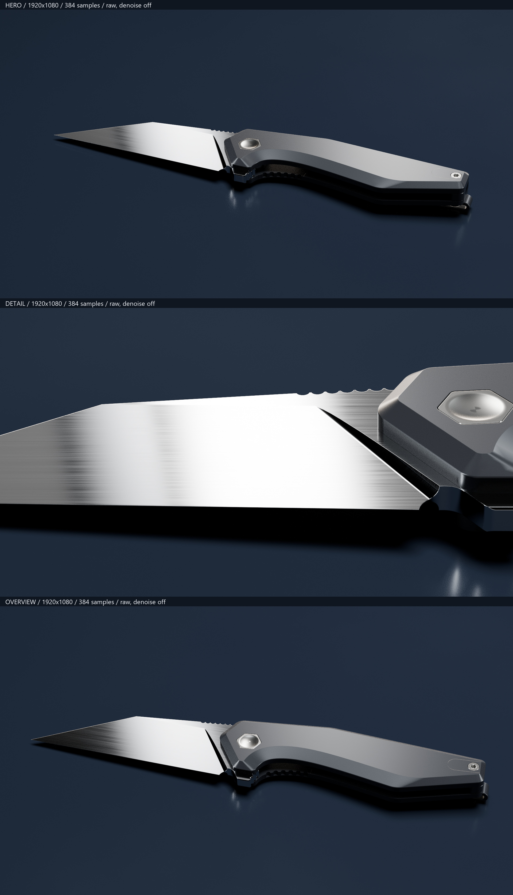

# Fenrir still review — 2026-10-11

Reviewer: Codex lead agent. Viewed contact sheet & all three original 1920×1080 PNGs through image inspection this turn, before further code changes. This is agent observation, not Adrian's acceptance.

Source: [render identities & technical checks](fenrir-lookdev-2026-10-10.json), code `298e3b74576d26834ad19811f1bee5b3a93771d9`. Contact sheet is copied unchanged from local render output; full PNGs remain in recorded local directories.

| View | Visible finding |
|---|---|
| Hero | Complete silhouette fits, but large empty upper field weakens composition. Handle reads as smooth grey plastic/coated metal; no evidence establishes real product finish. Dark lower scales & mechanism blend into floor. |
| Detail | Broad near-white blade reflection conceals grain across centre. Long horizontal scratch bands look exaggerated. Pivot cap has an irregular dark mark; its cause is unverified. |
| Overview | Too similar to hero to prove distinct film coverage. Grain/noise remains visible around pivot & upper scale. Bright outline near rear screw needs investigation before acceptance. |

Disposition: reject these frames as product-finish approval or polished-ad evidence. Retain as historical lookdev. Adrian must identify variant, colour & actual part finishes, followed by photo-referenced swatches before further knife lookdev/film work.

Camera framing here is independently authored static framing; archived film paths have not been exercised. Passing geometry checks is not choreography validation.

History correction: `-1080-v2` denotes rerender after source-byte normalization for committed-code hash parity. It does not record an Adrian-approved aesthetic iteration. Floor changed from archived base 0.0035/roughness 0.12 to 0.007/0.20; no contemporaneous visual rationale was captured, so no rationale is invented here.
