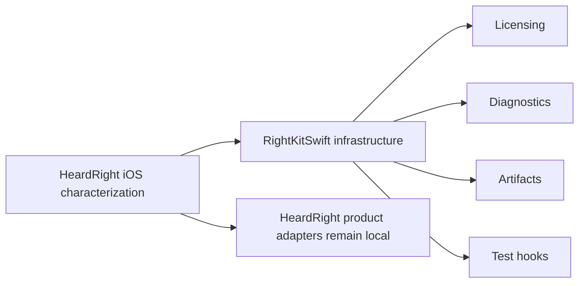

# RightKitSwift extraction contract

Status: **extracted, built, published (0.1.1)** on macOS. `RightKitSwift/` is the
canonical package source (builds + tests 16/16); it is published as a private git
package at `github.com/bogusyogi/rightkit-swift` (tag `0.1.1`) and consumed by apps
via git URL + version tag — see `RightKitSwift/README.md` for how, and
`docs/RIGHTKIT-SHARED-PACKAGES.md` for why git-URL rather than a registry. The
table below is the original extraction contract, kept as the record of what moved
and what stays app-local.

## Minimal package surface

| Target | Public contract to extract | Current evidence | Keep app-local |
|---|---|---|---|
| `RightKitLicensing` | `LicenseConfiguration`, `SignedEntitlement`, `EntitlementVerifier`, `LicenseAPIClient`, `LicenseStore`, `KeychainLicenseStore` | `heardright/ios-native/Shared/LicenseEntitlement.swift`; `heardright/ios-native/HeardRight/LicenseController.swift` | `LicenseController`, UI messages, app/key-prefix policy, URLs, service/account names, StoreKit combination policy |
| `RightKitDiagnostics` | `DiagnosticEvent`, `DiagnosticsEnvelope`, `PrivacyRedactor`, bounded `JSONLDiagnosticStore` | `heardright/ios-native/Shared/DiagnosticsReport.swift`; `DogfoodTraceStore.swift` | HeardRight snapshot fields, shortcut names, app group, event taxonomy, diagnostics screen |
| `RightKitArtifacts` | `ArtifactDescriptor`, `ArtifactManifest`, `ArtifactDownloadClient`, `ArtifactInstaller`, `ArtifactCache`, `ArtifactState`, validation callback | `ModelArtifactInstaller.swift`; generic download/retry/cancellation seams in `ModelDownloadStore.swift` | ASR model catalog, routes/digests, Core ML stage vocabulary, UI strings, background-session identifier, runtime warming/orchestration |
| `RightKitQA` | injectable clock/session/filesystem/key store plus golden-vector and fault-injection fixtures | `ios-native/Tests/main.swift`, `model_install_smoke.swift`, `model_store_smoke.swift`, `coreml_validator_smoke.swift`, `dogfood_logging_contract_smoke.py` | HeardRight UI/device journeys and product assertions |

## Extraction rules

- Configuration is injected. No `heardright`, `app.heardright`, `HR-`, product URL, app-group, model name, route, digest, StoreKit ID, or brand copy may enter the package.
- A paid entitlement is active only after Ed25519 verification, app/device binding, and expiry checks. Network refresh failures remain observable; shared code must not silently convert them into success.
- Keychain accessibility and service/account identifiers are explicit configuration. The package never logs keys, activation tokens, signed tokens, bearer tokens, or device identifiers.
- Artifact downloads require an expected SHA-256 before install. Installation uses staging plus atomic replacement, preserves the previous valid artifact until validation succeeds, rejects traversal/links/unsupported archive members, caps expansion, excludes caches from backup, and supports rollback.
- Core ML, ASR, StoreKit, keyboard, Live Activity, App Intents, audio session, navigation, and visual design are product behavior, not shared infrastructure.
- The package may expose protocols and value types; product-facing `ObservableObject` controllers stay in app repos.

## Canonical contract

`contracts/license-v2.json` is byte-identical to the Rust and TypeScript public vector. Run `pnpm test:swift-contracts` from `tools/rightkit` to prove byte parity, Ed25519 validity, and payload semantics on Windows or macOS. Swift tests must load this file rather than embedding another token.

The Mac extraction and publication gates are in [MAC-EXTRACTION-CHECKLIST.md](./MAC-EXTRACTION-CHECKLIST.md).
